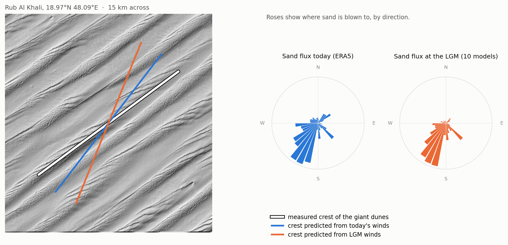
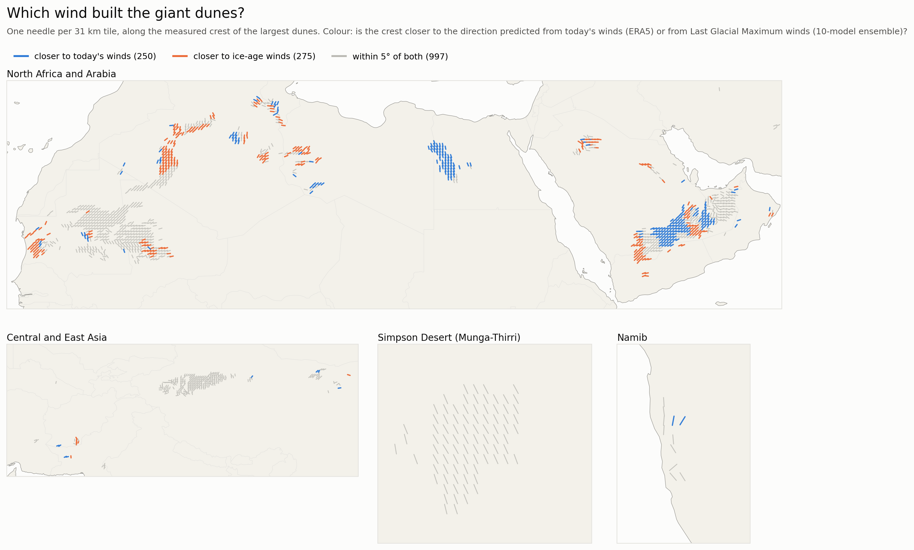
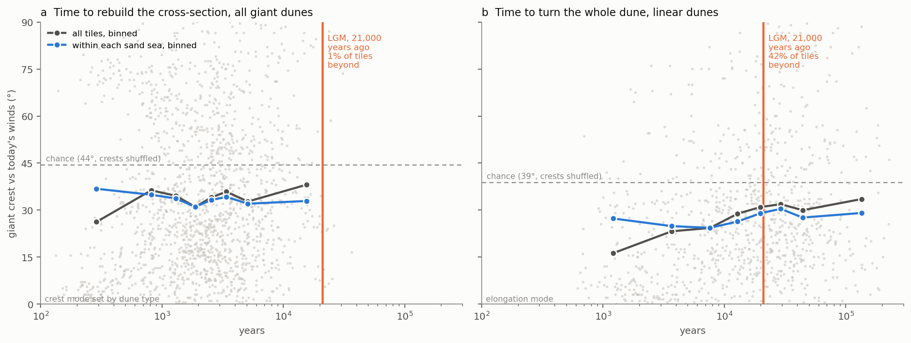
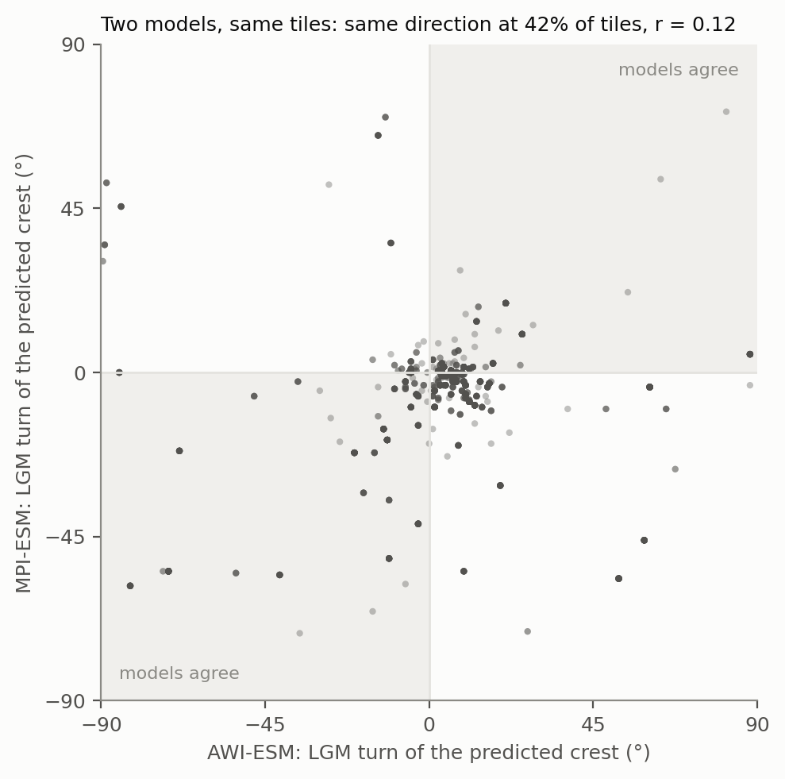
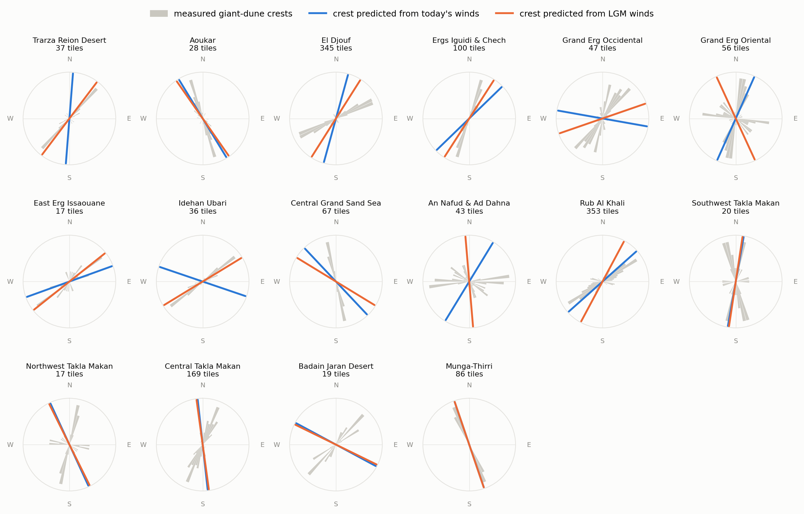
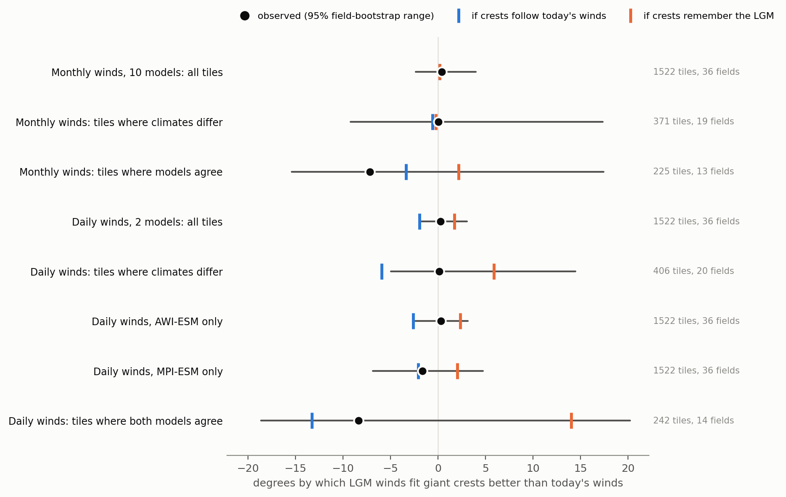

# Fossil Wind Vanes

**Do the giant dunes of the world's sand seas still point along the winds of the last ice age?**

Giant dunes, a kilometre or more from crest to crest, take thousands of years to turn. Small dunes reshape within decades. If the big ones are slow enough, their crests should still line up with the winds of the Last Glacial Maximum (LGM, about 21,000 years ago), while the small dunes on their backs follow today's winds. A sand sea would then be a fossil wind vane, and a check on what climate models say ice-age winds were.

This project measures crest directions across 38 sand seas, predicts the crest each climate would build from sand-flux physics, and asks which prediction the dunes match.



## What it finds

- **Today's winds explain giant crests well above chance.** From ERA5 winds, the predicted crest misses the measured giant-dune crest by 33.6 deg on average, against 44.4 deg when crests are shuffled between tiles and 38.0 deg when shuffled within each sand sea. Giant crests fit the *elongation* mode of dune growth (dunes extend along the net sand transport) much better than the *bed instability* mode (crests set across the strongest transport): 33.8 deg against 52.1 deg. In the Simpson Desert the median tile is within 5 deg.
- **Ice-age winds do not fit better, but the test could not have told.** Using the mean change in monthly winds from ten PMIP climate models, the ice-age prediction fits 0.4 deg better (95% range -2.4 to +4.0). A benchmark that plants each hypothesis into the real data shows why this means nothing: at these tiles the mean-misfit test expects the same result whether crests follow today's winds or remember the LGM. Its power to detect perfect memory is 2%.
- **The climate models disagree about ice-age desert winds.** Two models with daily winds (AWI-ESM and MPI-ESM) turn the predicted crest the same way at only 42% of tiles, and their turns correlate at r = 0.12. Across the ten monthly models the median pairwise correlation is 0.16. The dunes cannot pick out a signal the models do not share.
- **Daily winds give the test some power, and the answer sits in between.** With daily winds, the expected result is -2.0 deg if crests follow today's winds and +1.7 deg with perfect memory. The observed +0.3 deg (95% range -1.9 to +3.1) is about 60% of the way to perfect memory, with a range from 3% to 137%.
- **Correcting for model noise, the memory fraction is unknown.** Estimated as a regression slope, the fraction of the predicted ice-age turn that shows up in the crests is 0.0 to 0.3 for most predictions. That slope is dragged toward zero by noise in the predicted turns. Using half the models as an instrument for the other half removes that bias and gives -0.1 across all tiles (95% range -1.4 to +1.8): no information either way.
- **Where models agree on a big turn, crests lean modern, weakly.** At 225 tiles in 13 fields where at least 8 of 10 models turn the crest the same way by 10 deg or more (median 19.5 deg), today's winds fit better by 7.2 deg, but the range (-15.4 to +17.4) is too wide to conclude anything.
- **A test with no climate model finds no clear memory.** If giant dunes kept old orientations, slow dunes should sit further from today's winds than fast ones in the same sand sea. Measured by the time to rebuild a dune's cross-section, they do not: -5.7 deg per tenfold increase in turnover time (95% range -14.3 to +3.5).
- **Many long dunes are too slow to have turned since the ice age, and they fit today's winds almost as well.** Rebuilding a cross-section takes a median of 2,200 years, but turning a whole dune means moving sand along its length. By that measure 42% of linear-dune tiles need longer than the 21,000 years since the LGM. Within the same sand seas these slow linear dunes sit 1.7 deg further from today's winds than fast ones (95% range -2.9 to +6.0): the direction memory predicts, but small and not significant. Either long dunes turn faster than this estimate, or the direction of sand-moving winds over these deserts has changed little since the LGM.
- **Young dunes in satellite images do not follow today's winds.** Sentinel-2 imagery sees the giant crests that the elevation model sees (median difference 4 deg). It finds a second, smaller crest set 40 to 150 m apart in 54% of tiles, but those crests sit barely closer to either predicted direction than crests shuffled between tiles (50 deg to the bed-instability prediction against 53.5 by chance; 37.4 deg to the elongation one against 38.0). Bending today's winds toward the giant crest, as giant dunes do near the ground, does not help: with the bending strength fitted on half the sand seas, the other half still sit at 50.7 deg against 53.3 by chance. As planned, the young-dune comparison is not interpreted.
- **Weighting the models by skill does not rescue the ice-age test.** All ten models reproduce today's monthly winds at the tiles better than chance (errors of 1.1 to 2.4 m/s). Weighting them by that skill gives a memory fraction of -0.09 (95% range -0.58 to +0.42), and the less skilful models are, if anything, the ones whose ice-age winds fit the dunes best (Spearman 0.26, p = 0.47, ten models).

The question stays open. Giant crests follow today's winds about as well as fast dunes do, even where the physics says they are too slow to have turned since the ice age. That points either to faster turning than simple estimates give, or to sand-moving winds whose direction has changed little since the LGM; the dunes cannot separate the two. The climate models cannot settle it, because they disagree about where ice-age winds blew over the deserts.



## Turnover time, no climate model needed



Each grey point is a tile; the dashed line is the misfit when crests are shuffled between tiles. If giant dunes remembered older winds, slow dunes (right) should sit further from today's winds than fast ones (left). (a) Measured by the time to rebuild a dune's cross-section, almost every tile turns over well within 21,000 years, and within each sand sea (blue) the line is flat; the pooled rise comes from differences between sand seas. (b) Measured by the time to turn a whole linear dune, T = H x L / (4 x gross flux) with L the dune's length, 42% of tiles lie beyond the LGM line, and within sand seas the misfit rises only from about 25 to 30 deg.

| Version | Change in misfit per tenfold turnover time | 95% range |
|---|---|---|
| Primary: Gunn heights and wavelengths, within sand seas, wind directionality as a covariate | -5.7 deg | -14.3 to +3.5 |
| Heights and wavelengths from this project's DEM | -8.0 deg | -15.7 to +2.2 |
| Best of the two crest modes (no skill: 22.0 deg against 22.5 by chance) | +0.4 deg | -4.7 to +4.3 |
| Without the directionality covariate | -5.1 deg | -17.3 to +4.1 |
| Linear dunes only (907 tiles, 29 fields) | +5.2 deg | -7.1 to +18.4 |

Known-answer check: the fastest fifth of tiles (median turnover 480 years) fit today's winds at 29.6 deg, under the 35 deg bar set in advance.

**Turning time for the whole dune (test E).** The pre-registered version failed its known-answer check. By turning time, the fastest fifth are mostly short, non-linear dunes scored with the bed-instability mode, which fits poorly everywhere (40.7 deg, above the 35 deg bar), so its slope (-10.3 deg per tenfold, 95% range -15.2 to -3.4) is not interpreted. The best-of-two version is flat (+0.2 deg, -2.1 to +2.9), but best-of-two scoring has no skill over chance. Linear dunes with the elongation mode do have skill (27.4 deg against 38.8 by chance across tiles and 29.8 within sand seas), and for them:

| Linear dunes, elongation mode (907 tiles, 29 fields) | Result | 95% range |
|---|---|---|
| Change in misfit per tenfold turning time, within sand seas | +2.5 deg | -4.5 to +9.5 |
| Tiles slower than 21,000 years minus faster ones, same sand sea (19 fields) | +1.7 deg | -2.9 to +6.0 |
| Share of tiles slower than 21,000 years | 42% | |

## The models do not agree



Each point is a tile. Its position is how far each model's ice-age winds turn the predicted crest away from today's prediction. If the models agreed, points would fall in the shaded quadrants along the diagonal. Most do not.

| Comparison | Agreement |
|---|---|
| Daily winds, AWI-ESM vs MPI-ESM | same direction at 42% of tiles, r = 0.12 |
| Monthly winds, 45 model pairs | median r = 0.16 (range -0.23 to 0.47) |

## Field by field



Grey petals are the measured giant-dune crests in each sand sea; blue and orange lines are the crests predicted from today's and LGM winds (median over the field). Some fields sit on the modern line (Grand Erg Oriental, Rub al Khali), some on the LGM line (Idehan Ubari, Ergs Iguidi and Chech), and in the Taklamakan and the Simpson the two predictions barely differ. With the models disagreeing, these field-level contrasts are suggestive, not evidence.

## The tests

The analysis plan was written before any comparison of crests with predicted winds ([docs/PLAN.md](docs/PLAN.md)). Three dated addenda add the follow-up tests, each written before those tests were run; one amendment (the young-dune definition) followed a two-tile pilot of the imagery and preceded any comparison with winds.



For each test: the observed difference in misfit (positive means LGM winds fit better), its 95% range from resampling whole dune fields, and the result expected if crests followed today's winds (blue) or remembered the LGM perfectly (orange). The benchmarks keep each tile's real error, with a random sign per field, so they carry the same clustering as the data.

| Test | Tiles | Fields | Result (deg) | 95% range | Expected, today's winds | Expected, LGM memory |
|---|---|---|---|---|---|---|
| Monthly winds, 10 models, all tiles (primary) | 1,522 | 36 | +0.41 | -2.36 to +4.00 | +0.19 | +0.18 |
| Monthly winds, tiles where the climates differ by over 10 deg | 371 | 19 | +0.05 | -9.23 to +17.35 | -0.59 | -0.22 |
| Monthly winds, tiles where 8 of 10 models agree | 225 | 13 | -7.19 | -15.41 to +17.41 | -3.36 | +2.15 |
| Daily winds, 2 models, all tiles | 1,522 | 36 | +0.26 | -1.85 to +3.05 | -1.95 | +1.70 |
| Daily winds, tiles where the climates differ | 406 | 20 | +0.11 | -4.95 to +14.48 | -5.95 | +5.89 |
| Daily winds, AWI-ESM only | 1,522 | 36 | +0.31 | -2.39 to +3.12 | -2.60 | +2.35 |
| Daily winds, MPI-ESM only | 1,522 | 36 | -1.66 | -6.88 to +4.72 | -2.08 | +2.01 |
| Daily winds, tiles where both models agree | 242 | 14 | -8.36 | -18.61 to +20.22 | -13.29 | +14.00 |

Other pre-registered results:

- **Placebo.** Giving each field the predicted ice-age turn of a random other field gives results at least as large as the real one in 19% of 1,000 shuffles.
- **Small dunes.** 715 tiles have a short-wavelength crest set clearly oblique to the giant dunes. Today's winds predict those crests barely better than chance (39.8 deg against 45), so the small-dune tests (H2, H3) cannot be read. The gap between small and giant crests correlates with the predicted ice-age turn at r = 0.10 (95% range -0.03 to 0.19).
- **Young dunes (test D).** Check 1 passed: Sentinel-2 giant crests match the DEM's with a median difference of 4 deg over 1,495 tiles. Check 2 failed: oblique young crests (811 tiles) are 50 deg from the modern bed-instability prediction, so the paired comparison and the young-dune turnover step were not run.
- **Young dunes in bent winds (test F).** The two halves of the sand seas chose bending strengths of 0 and 45 deg, the top of the grid (flagged as implausible in advance). Held-out young crests sit at 50.7 deg from the bent-wind prediction against 53.3 by chance, so the check failed again.
- **Skill-weighted models (test G).** Weights range from 0.18 (CNRM-CM5, 1.06 m/s error) to 0.02 (MIROC-ESM and MRI-CGCM3, 2.4 m/s). Skill-weighted LGM winds: misfit difference -0.65 deg (95% range -3.3 to +2.5, benchmarks -0.14 and +0.52); on tiles where the climates differ, -4.3 deg (-12.4 to +10.8, benchmarks -1.2 and +1.6).
- **Best-of-two scoring.** Scoring each crest against whichever of the two modes fits better has no skill for giant dunes (22.0 deg against 22.5 for shuffled crests), so every best-of-two row in this project is uninformative.
- **Mid-Holocene** winds (6,000 years ago) fit slightly worse than today's: -1.9 deg (95% range -4.9 to +0.6).
- **Thresholds.** The daily-wind results barely move between sand-moving thresholds of 3, 4 and 5 m/s ([results/addendum.csv](results/addendum.csv)).

Exploratory memory fractions (0 = crests follow today's winds, 1 = perfect LGM memory), from [results/memory_slope.csv](results/memory_slope.csv), using tiles with errors under 60 deg:

| Prediction | Memory fraction | 95% range |
|---|---|---|
| Monthly, 10-model mean | 0.04 | -0.46 to 0.85 |
| Daily, 2-model mean | 0.25 | 0.08 to 1.46 |
| Daily, AWI-ESM | 0.25 | 0.06 to 0.81 |
| Daily, MPI-ESM | -0.03 | -0.28 to 0.80 |
| Monthly, split halves of the models (noise-corrected) | -0.30 | -1.82 to 1.70 |

The uncorrected slopes look like evidence against strong memory, but they are biased toward zero by the noise in the predicted turns. The corrected one is uninformative.

## How sure

**Crest measurement.** Tests plant synthetic dune fields with known crest directions and recover them to within 2 deg, including two superimposed scales. Harmonics of the giant dunes, which share their direction, are kept out of the short-wavelength measurement by masking 15 deg around the giant crest. On real data the method gives the known trends: Namib roughly N-S, Simpson NNW-SSE, south-west Rub al Khali NE-SW. The 30 m DEM resolves crests down to about 120 m apart.

**Predictions.** Sand flux uses a standard saturated-flux law with a threshold friction velocity of 0.25 m/s on a 300 micron sand. The two orientation modes and the 1.6 crest speed-up follow Courrech du Pont et al. (2014). Tests reproduce Rubin and Hunter's rule (two winds more than 90 deg apart build crests along the net transport, two closer winds build crests across it). Which mode applies was fixed in advance: elongation for linear dunes, bed instability otherwise. Star dunes are dropped.

**Ice-age winds.** The delta method adds each model's monthly change in mean wind (LGM minus its own pre-industrial control) to every ERA5 hour of that month. This cancels model bias in the mean climate but keeps only shifts in the mean, not in storms. That is why test A uses daily winds. Only two PMIP models published daily surface winds for the LGM. MPI-ESM's LGM run uses its last 20 years instead of 30 because the only server holding it slowed to 40 kB/s (logged in the plan before its result was computed). GISS-E2-R's LGM run is compared with its matching p141 control.

**Statistic.** The pre-registered statistic, the mean difference in angular misfit, loses its power where errors approach 90 deg, because the angle measure wraps around there. The tiles where models predict the biggest turns are often such tiles. The benchmark columns in the test table make that visible. The regression slope in the exploratory table does not have this problem but does suffer from noise in the predicted turns, which the split-half instrument corrects.

**Clustering.** All intervals resample whole dune fields (36 fields), since tiles in one sand sea share winds and history.

**Sand flux.** The ERA5 gross flux matches Gunn et al.'s independent ERA5 calculation at r = 0.98 (log scale), at 82% of their magnitude (different decade and grid); wind directionality agrees at r = 0.95.

**Imagery.** Sunlight shades crests unevenly depending on their direction, so each tile uses two scenes with the sun about 60 deg apart. The check against the DEM giant crests (median 4 deg) shows that this bias is small.

**Turning time.** T = H x L / (4 x gross flux) assumes all the gross flux works at turning the dune and that the length L is Gunn's long-axis width, which is capped near the 31 km tile size. Real dunes turn partly by growing new ends rather than swinging whole, so this is an order-of-magnitude scale, not a clock.

**Not covered.** Dune ages (giant dunes may record many glacial cycles, not one), changes in sand supply, and the possibility that LGM and modern sand-moving winds share a direction even where their means differ.

## Data

| Source | What | Access |
|---|---|---|
| [Gunn et al. 2022](https://doi.org/10.1038/s41467-022-30031-1), *What sets aeolian dune height?*, Nature Communications | 2,093 dune tiles in 38 sand seas, with large and small dune wavelengths and types | Source Data (CC BY) |
| [Copernicus DEM GLO-30](https://registry.opendata.aws/copernicus-dem/) | 30 m elevation, read tile by tile from the AWS open bucket; nothing stored but spectra | Free, ESA licence |
| [ARCO-ERA5](https://github.com/google-research/arco-era5) | Hourly 10 m wind, 6,000 random hours 1991 to 2020, at each tile | Google public bucket, Copernicus licence |
| [Sentinel-2 L2A](https://registry.opendata.aws/sentinel-2-l2a-cogs/) | Red band at 10 m, central 10 km of each tile, two clear scenes from opposite seasons (2021 to 2024); only spectra kept | AWS open data via the Earth Search catalogue, Copernicus licence |
| [PMIP3 and PMIP4 / CMIP5 and CMIP6](https://esgf.ceda.ac.uk/) | Monthly `uas`, `vas` for LGM, mid-Holocene and pre-industrial runs of 10 models; daily for AWI-ESM-1-1-LR and MPI-ESM1-2-LR | ESGF (CEDA, DKRZ, IPSL nodes) |

Models: AWI-ESM-1-1-LR, INM-CM4-8, MIROC-ES2L, MPI-ESM1-2-LR (CMIP6); CNRM-CM5, GISS-E2-R, IPSL-CM5A-LR, MIROC-ESM, MPI-ESM-P, MRI-CGCM3 (CMIP5). Each climatology is the last 50 simulated years.

This started as a different question: whether giant dune size is capped by the height of the atmosphere's lowest layer. Gunn et al. (2022) had already tested that across these same dune fields and found no link (r = -0.04), so the project turned to dune direction instead.

## Method

1. **Tiles** ([src/gunn.py](src/gunn.py)): Gunn's per-tile table, longitudes normalised.
2. **Spectra** ([src/orient.py](src/orient.py)): for each tile, a 0.28 deg window of the DEM is detrended, Hann-windowed and Fourier-transformed, and its power is saved on a 40 wavelength by 180 direction grid.
3. **Crests** ([src/spectra.py](src/spectra.py)): power in a band around Gunn's large wavelength gives the giant crest (peak of the smoothed direction profile). Below 0.6 of the smaller wavelength, prominent peaks at least 15 deg from the giant crest give oblique short sets.
4. **Winds** ([src/era5.py](src/era5.py), [src/pmip_find.py](src/pmip_find.py), [src/pmip_clim.py](src/pmip_clim.py), [src/pmip_daily.py](src/pmip_daily.py)): ERA5 hours at the nearest grid cell; PMIP climatologies interpolated to tiles; daily PMIP winds at the nearest model cell.
5. **Predictions** ([src/flux.py](src/flux.py), [src/predict.py](src/predict.py)): flux roses and the two crest modes for today, the mid-Holocene and the LGM, with a day-block bootstrap of the modern prediction.
6. **Model-free tests** ([src/turnover.py](src/turnover.py), [src/reorient.py](src/reorient.py), [src/s2.py](src/s2.py), [src/young.py](src/young.py), [src/bent.py](src/bent.py)): turnover time T = H x wavelength / (2 x gross sand flux) and turning time T = H x length / (4 x gross sand flux) per tile, regressed against misfit within sand seas; Sentinel-2 spectra rotated from UTM grid north to true north, with the two seasons' direction profiles averaged; ERA5 hours turned toward the giant crest by -k sin(2 x (wind - crest)) for the bent-wind test.
7. **Climate-model tests** ([src/analysis.py](src/analysis.py), [src/addendum.py](src/addendum.py), [src/power.py](src/power.py), [src/slope.py](src/slope.py), [src/skill.py](src/skill.py)) and **figures** ([src/figures.py](src/figures.py)).

## Reproduce

```
pip install -r requirements.txt
python src/gunn.py
python src/era5.py          # ~30 min, streams ~40 GB, keeps 92 MB
python src/orient.py        # ~1 h, streams the DEM, keeps 26 MB of spectra
python src/spectra.py
python src/pmip_find.py
python src/pmip_clim.py     # set PMIP_TMP to a folder with ~1 GB free
python src/predict.py
python src/analysis.py
python src/power.py
python src/pmip_daily.py    # ~2.5 GB of temporary downloads, deleted as it goes
python src/addendum.py
python src/slope.py
python src/turnover.py
python src/s2.py            # ~2 h, streams ~12 GB of imagery, keeps 36 MB of spectra
python src/young.py
python src/reorient.py
python src/bent.py
python src/skill.py
python src/figures.py
python -m pytest tests
```

Gunn's source data goes in `data/raw/gunn2022/source_data.xlsx` (Supplementary Data 5 of the paper).
